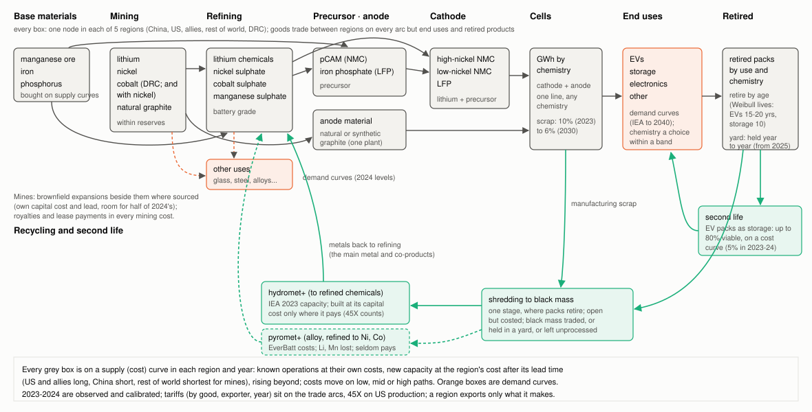
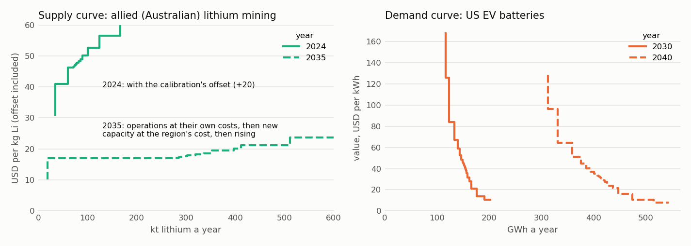
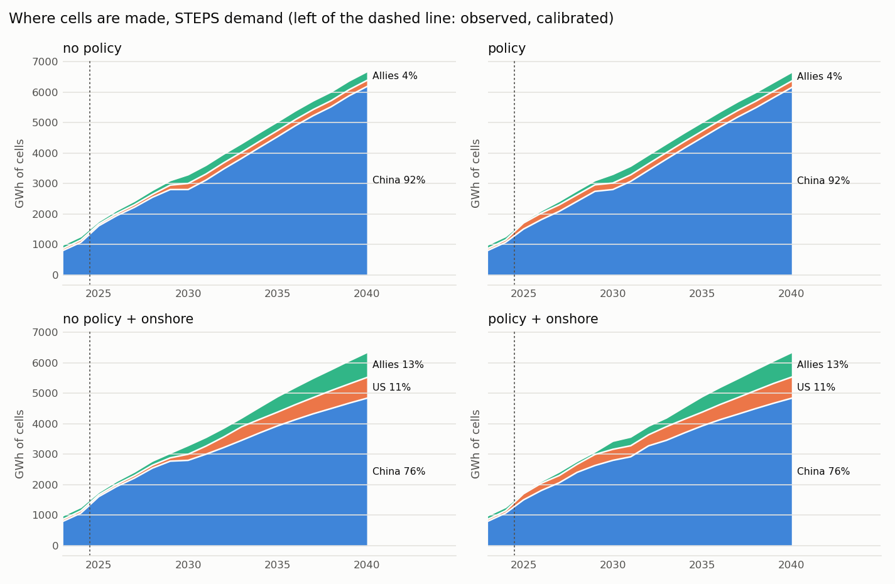
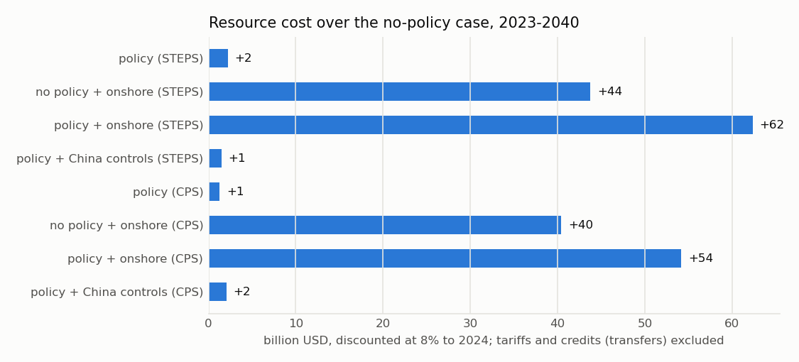
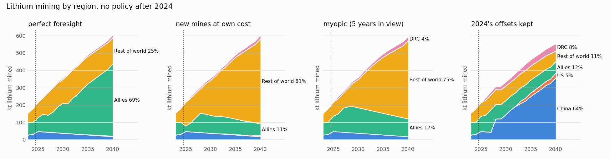

# The battery network to 2040

`critmin_net.horizon` projects the lithium-ion battery supply chain, from mines to end uses and back through
recycling, over 2023-2040 in five regions. 2023 and 2024 are observed and calibrated. After that, the model
decides where each stage is made, on supply, demand and cost curves, with each region's own lead times and,
optionally, current policy: US tariffs, the 45X credit and its foreign-entity rules, China's export controls and
the DRC's cobalt export quota. **Every number here is PRELIMINARY.** The figures are made by
`scripts/battery_horizon_figures.py` from the results that `scripts/battery_horizon.py` writes.

Credit: critmin-net is built on Erick C. Jones Jr.'s formulation; an early six-stage lithium prototype by Sara Alavi
(SEAR Lab) was its starting point, and the model has since been rebuilt. The energy-side context is Raziye
Aghapour's. The regional map and calibration are ours, not LLNL's (LLNL-TR-859392 supplies the regions).



## What is in it

- **Stages:** mining, refining to battery grade, precursor (pCAM for NMC, iron phosphate for LFP), anode
  material, cathode, cells, four end uses, and retired packs. Retired packs either get a second life as
  storage or are shredded into black mass, in one stage. Hydromet+ recovers the metals as refined chemicals and sends
  them back to refining. Pyromet+ smelts NMC black mass to an alloy and refines it to nickel and cobalt, losing the
  lithium and manganese (Argonne's EverBatt costs). Manganese ore, iron and phosphorus are base materials, bought
  rather than mined.
- **Yards:** retired packs and black mass can be held from year to year (from 2025) before reuse or recycling, or
  never processed.
- **Mines** can expand beside existing operations where an expansion's cost is sourced (brownfield, with its own
  capital cost and lead time), or open new mines at greenfield studies' costs. Royalties and government lease
  payments are part of every mining cost.
- **Regions:** China, the US, its allies (EU, UK, Japan, Korea, Canada, Australia...), the rest of the world, and the
  DRC (cobalt). Each box in the diagram is one node per region. Goods trade on every arc between regions except
  end uses and retired products, at a trade cost plus any tariff.
  - **Rules of origin** (every year): a region exports only what it made, so nothing passes through a low-tariff
    region.
  - **The DRC** builds no precursor, cathode, anode or cell plants by default (`no_entry`). It has none, and none is
    announced. Without this, as the one region with no US tariff, it became the US's cathode supplier.
- **Years:** 2023-2040.
  - 2023-2024 are observed. Their regional shares are reproduced within 0.5% of each stage's output (4% for
    graphite mining, whose natural/synthetic anode split is not observed).
  - Capacity built from 2023 decisions serves after each region's lead time.

### Three kinds of curve

Every market is a calibrated curve, never a fixed amount or a flat price, as in the lab's Texas energy-system
model. `horizon.audit()` refuses to solve while anything else is left, unless it has a written reason in `ALLOW`.

| Curve | On what | Anchored at | Knobs (`horizon.KNOBS`) |
|---|---|---|---|
| Supply (cost) | every stage, region, year | observed output, growing with the world's need, plus a 2% entry share | `supply_elasticity`, `entry`, `price_mult`, `retire` |
| Demand | end uses; the minerals' other uses; base materials (a supply curve on the whole market) | IEA's projection and its 2024 price; 2024 levels | `demand_elasticity`, `other_growth`, `base_share`, `base_elasticity` |
| Cost over time | operating and capital costs by stage | 2024's sourced costs | `cost_path` (`low`, `mid`, `high`) |

How a supply curve is built:
- **In the observed years,** known operations sit below the anchor at their own costs (`OPERATIONS`), for example
  Australia's four lithium mines from Greenbushes (7.8 USD per kg Li) to Wodgina (23.0). Then the curve rises.
- **In later years** the curve is a merit order:
  - existing operations, at their own size (retiring) and their own costs;
  - new capacity up to the anchor, at the region's sourced cost;
  - steps rising beyond the anchor.



The calibration sets each curve's **offset** in 2023-2024 so the network makes the observed shares. An offset is
a cost the sourced data leave unexplained: policy, contracts, logistics, or plants run at a loss in a price
slump. Australian lithium's 2024 offset is +20 USD per kg: at its operations' costs it would have mined far more
than it did. After 2024 the offsets fade to nothing by 2030 (`wedge_carry`), so from then where things get made
is the model's decision. The fade fits observed 2025 better than dropping the offsets at once (see the backcast
below).

### Building and lead times

Capital costs are annualised at 8% over 25 years, and every cost is discounted at 8%. Lead times are years from
decision to output, by stage and region:

| Stage | China | Rest of world | DRC | US | Allies |
|---|---|---|---|---|---|
| Mines | 5 | 2 | 3 | 10 | 5 |
| Refining (and hydromet) | 2 | 2 | 2 | 5 | 6 |
| Precursor, cathode | 1 | 2 | 2 | 4 | 4 |
| Anode | 2 | 2 | 2 | 3 | 3 |
| Cells | 1 | 2 | 2 | 3 | 4 |

- **Existing cell capacity** from 2025 is IEA's 2024 nameplate (China 2.8 TWh).
- **Retirement:** existing mines and refineries retire at 4% a year; new plants serve 25 years.
- **Shared plants:** one plant serves both anode routes, any cell chemistry, both NMC grades, and any black mass.
- **Chemistry** is a choice within 10 points of IEA's mix in each region.
- **Cobalt** is mined as a co-product of nickel, plus the DRC's copper-cobalt mines.
- **Recycling:** shredding is open but costed. Hydromet+ starts from IEA's 2023 capacity and is built only where it
  pays.
- **Second life:** in 2023-2024, 5% of retired packs (little was reused). After that, up to 80% of retired EV packs
  are viable (`second_life`), on a cost curve anchored at 20% of them. The anchor and the curve's slope are ours.

### Mines: expansions, new mines and royalties

From `battery_horizon/mining/` (165 rows, each checked against its source). USD per kg contained.

| | Allies | Rest of world | China | US |
|---|---|---|---|---|
| Lithium expansion, capital per kg a year | 47.9 (Pilgangoora, Greenbushes; 2 years) | 18.5 (Mali, Brazil, Argentina) | 115 (Qarhan) | 310 (Thacker Pass 2) |
| Lithium new mine, operating cost | 14.5 | 14.1 | own cost | 15.4 |
| Lithium royalty | 2.41 (Western Australia 5%) | 4.77 (Chile's CORFO payments, Argentina, Africa, Brazil) | 2.91 (provincial resource taxes by its mix) | none |
| Nickel expansion, capital per kg a year | 72.7 (Crawford) | 27.3 (Indonesian HPAL) | none | none |
| Nickel royalty | 0.42 | 0.27 (2% on MHP) | none added | none |

- Expansions have room for half of a region's 2024 capacity (ours).
- An Australian expansion costs more per unit than IEA's figure for a new Australian mine (48 against 28). Its edge
  is its lead time: 2 years against 5.
- **Chile's Atacama operations are held at their CORFO quotas** and do not retire (`QUOTA_OPS`, knob `quotas`):
  - Albemarle: 15.9 kt Li a year to 2043.
  - SQM: 32.5 a year over 2026-2030, the rest of its 406 kt.
  - The SQM-Codelco venture: 62.0 a year from 2031.

  Other new rest-of-world supply comes at greenfield cost.

### Policy

`critmin_net.policy`. 2023-2024 always carry the policy then in force. After them a run keeps current law
(`policy={}`) or drops it (`policy=None`).

- **US tariffs by good, exporter and year**, from official texts as of 2026-11-24:
  - MFN rates.
  - Section 301 on China: 25% across the chain.
  - The forced-labour Section 301 duty from 2026-07-24: China 12.5%, allies and others about 10%; minerals and
    refined chemicals exempt.
  - IEEPA and Section 122, as history only: IEEPA ended with the Supreme Court's ruling of 2026-02-20.
  - Chinese cells into the US pay 40.9% from 2027.
- **45X:** cells 35 USD per kWh; active materials and refined minerals 10% of production cost, recycled feed
  included. Under PL 119-21 components phase out over 2030-32 and minerals over 2031-33.
- **45X's foreign-entity rules** (`policy={"feoc": True}`): in each year a credit is paid, US plants take at most
  (1 - threshold) of their inputs from China.
- **China's export controls** (`policy={"china_controls": {"from_year": 2027}}`): no graphite, anode, cathode,
  precursor or cells from China to the US from that year. This is a scenario. The 2025 controls are suspended to
  2027-01-10.
- **The DRC's cobalt export quota:** 96.6 kt a year from 2026, on by default with policy (`drc_quota`).
- **Onshoring floors** (`run("onshore")`): the US and allies make 40% of their own demand at every processing and
  manufacturing stage from 2030, rising to 60% in 2040.

## Running it

```python
from critmin_net import horizon as H

inp = H.load("STEPS")                 # or "CPS": IEA's current policies demand
cal = H.calibrate(inp)                # curve offsets for 2023-2024
r = H.run("cost", inputs=inp, cal=cal)                     # no policy after 2024
r = H.run("cost", inputs=inp, cal=cal, policy={})          # current law kept
r = H.run("onshore", inputs=inp, cal=cal, policy={})       # plus onshoring floors
r = H.run("cost", inputs=inp, cal=cal, foresight=5)        # myopic, five years in view
r = H.run("cost", inputs=inp, cal=cal, policy={"feoc": True, "china_controls": {"from_year": 2027}})
r = H.run("cost", inputs=inp, cal=cal,
          knobs={"cost_path": "low", "supply_elasticity": {**H.KNOBS["supply_elasticity"], 'cell': 2.0}})
r["prod"][('cell', 'cell', 'US', 2030)], r["trade"], r["expanded"], r["resource_cost"], r["audit"]
```

`scripts/battery_horizon.py` runs every case and writes `results/battery_horizon/` (not committed);
`scripts/battery_horizon_figures.py` draws the figures here. A full Gurobi licence is needed; each case solves in
about three seconds.

## What it shows (PRELIMINARY)

These are STEPS demand, discounted to 2024, with resource cost excluding tariffs and credits (transfers).
Nothing is unmet in any case.



| Cells, 2040 | China | US | Allies | Rest of world + DRC |
|---|---|---|---|---|
| no policy | 92% | 3% | 4% | 1% |
| policy | 92% | 3% | 4% | 1% |
| policy + China controls | 92% | 3% | 4% | 1% |
| no policy + onshore | 76% | 11% | 13% | 1% |
| policy + onshore | 76% | 11% | 12% | 1% |

- **45X moves cells early, then fades.** With policy, the US makes 12% of the world's cells in 2025, 6% in 2030
  and 5% in 2033, as the credit phases out.
- **Policy changes who supplies the US, not where cells are made.** With tariffs, the US buys cathode, anode and
  cells from its allies and the rest of the world instead of China. China's export controls stop its remaining
  sales to the US. The foreign-entity rule adds little beyond the tariffs: it cuts China's anode to the US by up to a quarter in
  2030-2032, while the credit is paid.
- **Onshoring floors bind.** The US and allies make 24% of cells, cathode, anode and refined lithium in 2040.
- **China keeps refining.** Refined lithium is 87% Chinese in 2040 without floors and 71% with them.
- **Recycling** reaches about 1,380 GWh-equivalent of hydromet+ feed in 2040, and 250 in 2025. The yards buffer
  rather than hoard: holding costs Argonne's 150 USD per tonne a year (`yard_cost`), so about 170 GWh of retired packs
  sit in them in 2040. Free, 3,200 GWh piled up and 2040 recycling fell to 1,035.
- **Pyromet+ is never chosen,** not even Umicore's existing plant. Hydromet+ also recovers the lithium and manganese
  that pyromet+ loses to slag. It is there for scenarios, such as limits on hydromet+ or a low lithium price.



- **Onshoring** adds about 44 B USD (2.8%) to the discounted 2023-2040 cost, or 67 B USD with current policy as
  well.
- **Current policy alone** adds 14 B USD and pays 40 B USD of credits. China's export controls add under 1 B USD
  more.
- Totals include 2024's offsets while they fade (to 2030), so they are not comparable with 0.14.0's.

### The sensitive result: where lithium is mined



| Lithium mined, 2040 | China | US | Allies | Rest of world + DRC |
|---|---|---|---|---|
| no policy | 3% | 1% | 69% | 28% |
| no policy, new mines at own cost | 3% | 1% | 11% | 84% |
| no policy, myopic | 3% | 0% | 16% | 81% |
| no policy, 2024's offsets kept | 64% | 5% | 12% | 19% |

- **With the mining data, the allies (Australia) take the growth.** New mines there cost little to run (14.5 USD
  per kg), little to build (IEA's 28 per kg a year) and pay a low royalty (2.41). New rest-of-world supply costs
  about as much to run but twice as much to build (55), and pays twice the royalty. Chile's cheap brine grows only
  as its quotas allow (from 2031 the SQM-Codelco venture's 62 kt a year).
- **Three choices reverse it:**
  - pricing new mines at each region's existing cost (0.12.1's rule; the rest of the world's is 11.4, held down by
    Chile's brine);
  - planning only five years ahead, which favours the rest of the world's 2-year lead over the allies' 5;
  - keeping 2024's unexplained costs, which favours China.
- Rest-of-world expansions fill their room (61 kt) by 2028. Australian expansions are not built, since a new
  Australian mine is cheaper per unit.
- Refining, cathode, cells and the cost of onshoring barely move between these cases. The offsets-kept case counts
  the offsets as costs, so its total is not comparable with the others.

### Does it reproduce 2025?

Calibrated on 2023-2024, the model's 2025 is compared with what was observed (`scripts/battery_backcast.py`; 258
checked rows in `data/battery_horizon/backcast/`, one source per stage: USGS for mining, IEA for cells, refining,
cathode and anode). 2025 demand is an input, so the test is where things were made.

- With the offsets fading to 2030, the regional shares miss by 2.9 percentage points on average, and by 12.6 at
  most (China's share of nickel-based cathode: 54% against 67%).
- Dropping the offsets at once in 2025 missed by 4.3 on average and 18.9 at most (cobalt refining). The allies'
  cells fell to 2% against 12% observed; with the fade they are 7%. Keeping the offsets forever missed by 3.4.
- Close: graphite mining, refined lithium (China 75% against 74%), LFP cathode, anode, China's cells (80% against
  82%).
- Furthest: nickel mining (allies 24% against 15%), cobalt from nickel mines (rest of world 15% against 22%), the
  US's cells (12% against 6%: 45X).

### The scenario set

`scripts/battery_scenarios.py` runs every combination of the axes the sensitivity sweep and the backcast showed
matter:

| Axis | Values |
|---|---|
| Demand | IEA STEPS, CPS |
| Policy | none; current law; current law plus onshoring floors; current law plus China's export controls |
| New mines | the greenfield studies' costs; each region's own cost |
| Foresight | perfect; five years (myopic) |
| Persistence of 2024's patterns | fade by 2030; kept |
| Cost path | low, mid, high |

That is 192 runs, about 20 minutes on one machine with six at a time. Each run is exported for cem-impacts, and
`scripts/battery_scenarios_summary.py` reads across them. All 192 solve with no unmet demand.

| Result, 2040 | Range over the 192 runs | What moves it |
|---|---|---|
| China's share of cells | 73-95% | policy: 92% without floors, 75% with them |
| US and allies' share of cells | 4-25% | policy: 7% without floors, 24% with them |
| China's share of refined lithium | 63-87% | policy: 85% without floors, 73% with them |
| Allies' share of lithium mining | 7-69% | new-mine costs (29% studies, 15% own cost), persistence, foresight |
| China's share of lithium mining | 3-64% | persistence (3% fading, 32% kept) and foresight |
| Recycling (GWh-equivalent) | 920-1,580 | cost path, demand |
| Cost against no policy | -18% to +31% | cost path, persistence; floors add about 7%, current law about 1% |

Where cells and refining are made turns on policy alone; where lithium is mined turns on what nobody publishes (new
mines' costs, how long today's patterns last, how far ahead investors look).

Myopic runs had two artefacts until 0.15.1, both fixed:
- A window charged a new plant's capital only to the window's end. A plant built in its last year then cost a
  year's annuity, so the US built half the world's cells for 45X's last full year. Capital is now charged to 2040
  in every window.
- The onshoring floors are shares of output. With plants unable to arrive in time, the model met them by shrinking
  the market (cells in 2040 fell to about a quarter). They are now soft: a shortfall costs 100 USD per kg or kWh
  (`floor_penalty`). That is above their shadow prices with perfect foresight, so there they are met in full.

## What is still weak

- **Elasticities nobody publishes:**
  - EV and storage demand with respect to battery price (the EV one is derived from vehicle prices);
  - supply for refining, components and cells;
  - graphite supply.

  Those are stated values, marked "ours" in `horizon.py`.
- **Cost paths:** none were found for refining, mining or components, so they are held flat (mining 15% dearer in
  the high path, ours).
- **Nameplate capacity** is in hand only for cells and recycling.
- **Mining medians** rest on three to five projects each, some of them studies, not outturns. Lithium's regional
  split turns on them.
- **Royalties:**
  - They are held at 2024 values; ad valorem royalties do not rise and fall with prices.
  - Jiangxi's 6.5% comes from its miners' reports, not the provincial decision.
  - Indonesia's ore royalty is taken to be in the HPAL plants' ore costs.
  - Zimbabwe's 7% rests on a secondary source.
- **Pyromet+ costs** are model runs of EverBatt (2017 equipment, US, China and Korea), not plant outturns. China's
  and Korea's operating costs are derived from their totals with the US's capital charges (ours).
- **Chile's quotas** are annual averages of cumulative limits.
- **The foreign-entity rule treats China as the foreign entity by location.** Ownership (Chinese firms' plants
  elsewhere) is not modelled.
- **The DRC's no-entry default** is a hard limit, as a knob (`no_entry=[]` lets it build on its curves).
- **The supply curves' share persistence** (anchors growing with each region's 2024 output) and the 2% entry share
  are knobs to test.

## Data

All data are in `src/critmin_net/data/`, one row per number with its source; `SOURCES.md` lists them, and each
folder's `verification.csv` is an independent check of the rows the model uses.
- `battery_horizon/`: demand and lead times.
- `battery_horizon/policy/`: tariffs and credits.
- `battery_horizon/curves/`: cost paths, elasticities, and operations' output and costs.
- `battery_horizon/mining/`: expansions, greenfield costs, royalties, quotas, pyrometallurgy.
- `battery_costs/`: operating and capital costs.
- `battery_2023_2024/`: the observed years.
